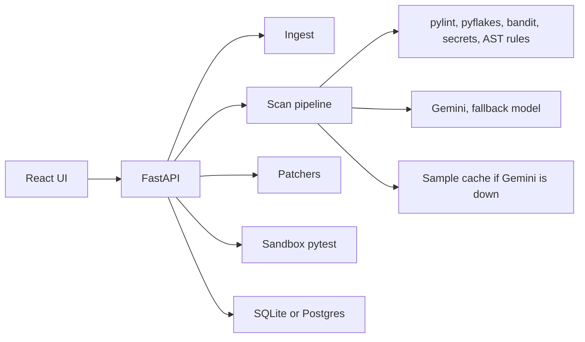

# AutoPatch

Autonomous bug detection and repair for SAPTHAHACKS'26, Problem Statement 02.

A developer uploads Python code. AutoPatch scans it with real static tools and, when a key is set, Google Gemini. Each bug report says what triggers the bug and why. A minimal patch is proposed as a unified diff and a side-by-side before/after. Tests run in a sandbox before and after the patch. Nothing is written into the project until a person accepts it.

## Problem

Students and junior developers can see that a program is wrong and still not know which line is at fault, why that line fails, or whether a fix broke something else. The marks calculator in the brief is the running example: it accepts negative marks and marks over 100, and it crashes when the list is empty. AutoPatch is built to catch that class of mistake, explain it in plain language, patch only the lines that need to change, and show the test that proves it.

## Solution

Five steps, in the sidebar:

1. **Upload** a file, a zip, or a public GitHub URL. The app shows the file tree, languages, dependencies, important files, and an import graph.
2. **Scan** with two layers. Layer 1 is pylint, pyflakes, bandit, and a secret scanner. Layer 2 is Gemini (`GEMINI_API_KEY`), with a second model, retries, and a timeout. Findings are merged. If Gemini is missing, bundled samples still scan and show clearly labelled cached model notes.
3. **Explain** the root cause: the input that triggers the bug, and why the code does the wrong thing. Student mode shortens that. Kannada and Hindi are available for the bundled rules, and via Gemini when a key is set.
4. **Fix** with a small patch. The screen shows a unified diff and the before (red) and after (green) code. Accept or reject is required. "Apply all safe fixes" only applies high-confidence patches whose tests passed.
5. **Test** existing tests, then generated edge cases (normal, minimum, maximum, invalid), before the patch and after it, then the full suite as a regression check. Progress streams over server-sent events. The code runs in a temp directory with CPU, memory, file-size, and wall-clock limits.

Every bug report has the same six sections: bug details, root cause, suggested patch, test results, severity and confidence, and change history. Low confidence is marked "needs human review".

## Where each requirement lives

| Requirement | Where it is implemented |
| --- | --- |
| Upload a single file, a zip, or a public GitHub URL | `backend/app/ingest/files.py`, `backend/app/ingest/github.py`, Upload page |
| File tree, languages, dependencies, important files, import graph | `backend/app/ingest/structure.py`, Scan page |
| Layer 1: pylint, pyflakes, bandit, secret scanning | `backend/app/analysis/static_runner.py`, `secrets.py` |
| Layer 2: Gemini for logic errors, edge cases, wrong outputs, crashes | `backend/app/llm/gemini.py` |
| Fallback model, retries, timeouts | `Gemini.analyze_with_gemini`, `GEMINI_FALLBACK_MODEL`, `GEMINI_TIMEOUT_S` |
| Merge and dedupe findings | `backend/app/analysis/merge.py` |
| Root cause in plain English, including the trigger | `backend/app/analysis/catalog.py`, Explain and bug pages |
| Student mode | Header toggle, `frontend/src/lib/format.ts` |
| Kannada and Hindi | Stored on each rule; `POST /api/bugs/{id}/translate` calls Gemini if a stored line is missing |
| Minimal patch, unified diff, side-by-side red/green | `backend/app/patching/`, Fix page, `DiffView.tsx` |
| Existing tests, generated normal/min/max/invalid tests, before and after, regression | `backend/app/testing/generate.py`, `testing/service.py` |
| Sandbox: temp dir, CPU, memory, time, truncated output | `backend/app/sandbox/runner.py` |
| Live test progress | `GET /api/test-runs/{id}/events` (SSE), Test page |
| Severity, impact, calibrated confidence, "needs human review" | `catalog.py` (`REVIEW_BELOW = 0.8`), bug report, dashboard |
| Dashboard charts | Dashboard page, recharts |
| Accept or reject every patch; nothing applied without approval | `services.decide_patch`, Fix page |
| "Apply all safe fixes" only for high-confidence patches whose tests passed | `services.apply_safe` |
| SQLAlchemy, SQLite default, Postgres via `DATABASE_URL` | `backend/app/db.py`, `models.py` |
| History of scans, bugs, patches, tests, decisions | `history_events` table, History page |
| Export fixed project zip, report PDF, report JSON | `backend/app/exporting/report.py` |
| Bug report fields: details, root cause, patch, tests, severity and confidence, change history | `GET /api/bugs/{id}`, bug page headings |
| Marks calculator (negative and over-100 marks) | `samples/marks_calculator/` |
| 5–8 buggy projects with ground truth | `samples/` (8 projects, 12 bugs) |
| Measured detection, fix success, false positives | `benchmark/run_benchmark.py`, `benchmark/results/latest.json`, Benchmark page |
| One-click demo from the home page | Home page sample cards, `?auto=1` starts the scan |
| Demo mode when Gemini is missing or fails | `analysis/pipeline.py`, `samples/cache.json` |
| Upload size limits, rate limiting, validation, structured logs | `ingest/files.py`, `limiter.py`, `logging_config.py` |
| pytest, frontend tests, GitHub Actions | `backend/tests/`, `frontend/src/**/*.test.ts(x)`, `.github/workflows/ci.yml` |
| One Dockerfile, Render free tier | `Dockerfile`, `render.yaml` |

## What a strong solution shows

| What judges should be able to see | Where |
| --- | --- |
| The whole workflow, not a chat box | Sidebar steps Upload → Scan → Explain → Fix → Test |
| A real static layer plus a model layer, and a demo that still runs if the model is down | Scan page banner, tool notes, cached model chip |
| An explanation of the trigger, not only a line number | Root cause and "What triggers it" on the bug page |
| A small patch and a human decision | Fix page, Accept / Reject, history event |
| Proof the patch worked and did not break existing tests | Test page: existing before, generated before, generated after, regression |
| Severity and a confidence that can say "a person should check this" | The stock-total sample is medium confidence and flagged for review |
| Numbers from a run, with the method written down | Benchmark page and the method paragraph in `benchmark/results/latest.json` |
| The marks-calculator example from the problem | Home card "Marks calculator", `samples/marks_calculator` |

## Architecture



More detail is in [docs/ARCHITECTURE.md](docs/ARCHITECTURE.md). The three-minute demo is in [docs/DEMO_SCRIPT.md](docs/DEMO_SCRIPT.md). Interactive API docs are at `/docs` when the server is running.

## Benchmark results

Measured by `python benchmark/run_benchmark.py` on 19 Nov 2026. Gemini was not called. Eight projects, twelve ground-truth bugs.

| Metric | Result |
| --- | --- |
| Detection rate | 100% (12 / 12) |
| Fix success rate | 100% (12 / 12) |
| False positives | 0 |

Projects: marks calculator, bank balance, login SQL injection, off-by-one, division by zero, hardcoded secret, mutable default argument, skipped first stock row. The raw rows are in `benchmark/results/latest.json`. Re-run the script or the Benchmark page to measure again. The pytest suite asserts these rates, so a regression fails CI.

Style notes from pylint (a long line, a suggestion to use `enumerate`) are shown in the UI and are not counted as false-positive bugs. That choice is written in the benchmark method string.

## Tech stack

- Backend: Python 3.12, FastAPI, SQLAlchemy, pydantic, pylint, pyflakes, bandit, httpx, fpdf2, pytest
- Model: Google Gemini (`gemini-2.5-flash`, fallback `gemini-2.0-flash`)
- Frontend: React, Vite, TypeScript, Tailwind, recharts
- Data: SQLite by default, Postgres when `DATABASE_URL` is set
- Deploy: one Docker image, Render web service

## Security and the sandbox

- Uploads are capped (8 MB by default). Zips are checked for path traversal and for a zip bomb (file count and uncompressed size).
- GitHub imports accept only `https://github.com/owner/repo`. The download is capped at 8 MB. No credentials are sent.
- User code runs with `subprocess` in a temp copy. The child does not receive `GEMINI_API_KEY`, `DATABASE_URL`, or other secret environment variables. CPU, address-space, file-size, and wall-clock limits are set. Output is truncated.
- Network is not a separate namespace. Isolating the network with `unshare` needs privileges this service does not assume. The child still has no API keys.
- Patches are not written until Accept, or until "Apply all safe fixes" after tests have passed.
- Secrets found in a scan are stored as findings. Do not upload a real production secret.

## Limitations

- Python is the language the rules, fixers, and generated tests understand well. JavaScript and TypeScript are ingested, shown in the tree, and secret-scanned. They are not patched.
- The fixers cover the bug classes in the benchmark (range checks, empty division, zero division, deposits and withdrawals, SQL f-strings, hardcoded secrets, mutable defaults, two off-by-one shapes). A novel logic bug needs Gemini, and the patch may still need a person.
- The skipped-first-row rule is deliberately low confidence. Some loops start at 1 on purpose. It is flagged for human review and is not auto-applied.
- Confidence numbers are set by the rule, not learned from a large labelled set. They are calibrated against these samples: the rules that are structural (mutable default, SQL interpolation) sit higher than the heuristic ones.
- Gemini model names change. If both models fail, the scan continues on the static layer.
- The sandbox cannot stop every abuse. It is a limit around a student program, not a hardened multi-tenant jail.

## Run it locally

```bash
cd backend
python3 -m venv .venv
.venv/bin/pip install -r requirements.txt
.venv/bin/pytest
cd ../frontend
npm ci
npm test
npm run build
cd ../backend
.venv/bin/uvicorn app.main:app --reload --port 8000
```

Open http://127.0.0.1:8000 . For frontend hot reload, run `npm run dev` in `frontend/` and open http://127.0.0.1:5173 . The dev server proxies `/api` to port 8000.

Copy `.env.example` to `.env` if you want Gemini. Leave `GEMINI_API_KEY` empty for demo mode.

```bash
python benchmark/run_benchmark.py
```

## Deploy on Render

The repo includes `render.yaml` and a Dockerfile that builds the frontend and serves it from FastAPI. Create a Render web service from this repo (free plan). Set `GEMINI_API_KEY` in the dashboard if you want live model findings. Set `DATABASE_URL` only if you attach Postgres; otherwise the service uses SQLite on local disk, which resets when the free instance sleeps. The health check is `/api/health`.

## API

| Method | Path | Purpose |
| --- | --- | --- |
| GET | `/api/health` | Liveness, whether Gemini is configured |
| GET | `/api/samples` | Bundled demos |
| POST | `/api/projects/upload` | File or zip |
| POST | `/api/projects/github` | `{ "url": "https://github.com/owner/repo" }` |
| POST | `/api/projects/sample` | `{ "sample_id": "marks_calculator" }` |
| GET | `/api/projects/{id}` | Tree, languages, dependencies, graph |
| POST | `/api/projects/{id}/scans` | Run both layers |
| GET | `/api/bugs/{id}` | Full bug report |
| POST | `/api/bugs/{id}/translate` | `{ "language": "kn" }` or `"hi"` |
| POST | `/api/patches/{id}/decision` | `{ "action": "accept" }` or `"reject"` |
| POST | `/api/scans/{id}/apply-safe` | High-confidence patches whose tests passed |
| POST | `/api/projects/{id}/tests` | Start a proof run |
| GET | `/api/test-runs/{id}/events` | Server-sent events |
| GET | `/api/projects/{id}/history` | Change history |
| GET | `/api/projects/{id}/dashboard` | Counts for the charts |
| GET | `/api/projects/{id}/export/json` | Report JSON |
| GET | `/api/projects/{id}/export/pdf` | Report PDF |
| GET | `/api/projects/{id}/export/zip` | Workspace zip |
| POST | `/api/benchmark/run` | Re-measure the samples |
