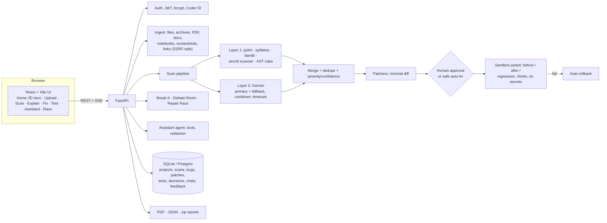

# FixPilot

**Find it. Fix it. Prove it.** FixPilot finds bugs in your code, explains why they happen in plain words, writes the smallest fix, and runs tests to prove the fix works. Nothing changes until a person says yes.

**Team CRACKERS** · SAPTHAHACKS'26 · **Problem Statement 02: AutoPatch** (autonomous bug detection and repair)

| | |
| --- | --- |
| **Live app** | https://autopatch-7yyu.onrender.com |
| **Code** | https://github.com/shrinidhigowda2010/autopatch |
| **Stack** | FastAPI · React + Vite + TypeScript · Google Gemini · SQLAlchemy (Postgres) · Docker on Render |

## Try it in 60 seconds

1. Open the [live app](https://autopatch-7yyu.onrender.com). The free server sleeps when idle, so the first load can take about 30 seconds.
2. Scroll to **Try a sample** and click **Marks calculator**. The scan starts by itself (no account needed).
3. Click a bug to read the root cause. Switch the language to **ಕನ್ನಡ** or **हिन्दी** at the top.
4. Go to **Fix**: approve, reject, edit or skip each fix. **Undo** puts the code back.
5. Go to **Test** and press **Run the tests**: the new tests fail on the old code and pass on the fixed code.
6. Bonus: **🏁 Repair Race** (`/race`) times the whole find, fix and verify loop on a real stopwatch.

## How it maps to PS02

| PS02 asks for | FixPilot |
| --- | --- |
| Detect bugs automatically | Static tools (pylint, pyflakes, bandit, secret scan, AST rules) **plus** Gemini, merged into one list |
| Explain the root cause | The input that triggers it and why the code fails, in English, Kannada or Hindi |
| Generate a patch | The smallest change, shown as a before/after diff |
| Validate with tests | Generated edge-case tests run before and after in a sandbox, plus a regression run |
| Keep a human in control | Approve / reject / edit / skip each fix, auto-undo when tests fail, full decision log |

## How Gemini is used

- **Finding logic bugs** that rule-based tools miss, running in parallel with the static tools (`backend/app/llm/gemini.py`).
- **The FixPilot Assistant**: a streaming chat that calls real tools (scan, explain, propose fix, run tests) on your project.
- **Reading code from screenshots** with Gemini vision, **translations** to Kannada and Hindi, **alternative fixes** when you reject one, and the **AI Debate Room** (Breaker vs Fixer, then a Judge).
- **Reliability:** primary model `gemini-3.8-flash`, fallback `gemini-3.1-flash-lite`, short timeouts and a cooldown for overloaded models. Secrets are redacted before any code is sent.
- **Honest fallback:** if Gemini is unreachable, scans, fixes and tests keep working on static analysis and the sidebar says so (`/api/health` reports `gemini_status`). The benchmark below does not use Gemini at all.

---

## The problem (Problem Statement 02)

Students and junior developers can see that a program is wrong and still not know which line is at fault, why it fails, or whether a fix broke something else. The brief's example is a marks calculator that accepts negative marks and marks over 100. FixPilot catches that class of mistake, explains it in plain language, writes the smallest patch that fixes it, and runs tests to prove the fix works. Nothing is written until a person approves it.

## How FixPilot covers each requirement

| PS02 requirement | What FixPilot does | Where to see it |
| --- | --- | --- |
| **Bug detection** | Two layers. Static tools (pylint, pyflakes, bandit, a secret scanner, AST rules) always run. Gemini runs in parallel for logic errors, edge cases and crashes. Findings are merged and de-duplicated. | Scan page · `backend/app/analysis/` |
| **Root-cause explanation** | Each bug states the input that triggers it and why the code misbehaves. **Simple explanations** shortens it. Kannada and Hindi are supported. | Explain and bug pages · `analysis/catalog.py` |
| **Patch generation** | A minimal patch shown as a unified diff and a red/green side-by-side view. A rejected patch can ask Gemini for an alternative. | Fix page · `backend/app/patching/` |
| **Test validation** | Existing tests plus generated normal, minimum, maximum and invalid cases run before and after the patch, then a regression run. Everything runs in a resource-limited sandbox and streams live. | Test page · `testing/`, `sandbox/runner.py` |
| **Severity and confidence** | Every bug has a severity, impact and calibrated confidence. Anything below 80% is marked **worth a second look** so a person checks it. | Bug report, dashboard |
| **Human review** | Accept, Reject, Edit, Skip or **Ask why** on every patch. Auto-Correct Mode (*Ask me each time*, *Auto-apply safe ones*, or *Show all as a list*) re-runs tests after each approval and rolls back automatically on failure. | Fix page, Decision Log |
| **Change history** | Every scan, patch, test run and decision is stored against the user's Coder ID, with a version timeline (v0 → v1 → …), **Undo last fix** and **Undo all fixes**. | History, Decision Log |
| **Reports** | Download a PDF report, a JSON report (including the decision log), or a zip of the fixed project. | History page · `exporting/report.py` |

Every bug report has the same six sections: bug details, root cause, suggested patch, test results, severity and confidence, and change history.

## What makes it different

- **🛡 Break-It attack.** For any patch, FixPilot throws 10–15 hostile inputs at the old and new code (empty, None, negative, huge, NaN, unicode, wrong types) and shows a live scoreboard such as *"Old code failed 1/15 · New code survived 15/15"*.
- **⚖️ AI Debate Room.** A Breaker agent attacks the fix and a Fixer agent defends it over three streamed rounds. A Judge then rules **Safe** or **Needs changes** with a confidence score.
- **🏁 Live Repair Race.** A full-screen stopwatch (`/race`). Paste buggy code and watch the real pipeline go **Bug found → Fixed → Verified**.
- **📎 Upload almost anything.** Code files, zip/tar archives, PDFs, Word docs, Jupyter notebooks, **screenshots of code** (read with Gemini vision), pasted code, or a GitHub/Gist/Pastebin link. Ctrl+V works anywhere on the page.
- **✅ Auto-correct with approvals.** Safe fixes can be applied automatically only when confidence is at least 90%, the risk is "safe" and tests pass. Everything else waits for a person.
- **🪪 Coder ID.** Every account gets an ID such as `FP-CODER-7F3K2`, which you can use to sign in. History, decisions and reports are tied to it.
- **💬 FixPilot Assistant.** A Gemini-style project chat with a personal greeting, Auto/Explain/Fix/Review modes, voice input (English, ಕನ್ನಡ, हिन्दी), file and screenshot attach, live tool steps, inline patch cards with Approve/Reject, and copy, regenerate and 👍/👎 on every reply. Feedback is stored.
- **Works without the network.** If Gemini is missing or down, the static layer, the project knowledge and the sandbox keep running, and the sidebar honestly shows *Gemini unavailable · static analysis on*.

## Architecture



More detail is in [docs/ARCHITECTURE.md](docs/ARCHITECTURE.md). A timed 5-minute walkthrough is in [docs/DEMO_SCRIPT.md](docs/DEMO_SCRIPT.md). Interactive API docs are at `/docs` when the server is running.

## Benchmark results (measured)

From `benchmark/results/latest.json`, produced by `python benchmark/run_benchmark.py`. Gemini is **not** called, so the score does not depend on an API key. There are 8 seeded projects with 12 ground-truth bugs.

| Metric | Result |
| --- | --- |
| Detection rate | **100%** (12 / 12) |
| Fix success rate | **100%** (12 / 12) |
| Projects fully fixed | **8 / 8** |
| False positives | **0** |

| Project | Bugs | Detected | Fixed |
| --- | --- | --- | --- |
| marks_calculator | 2 | 2 | ✅ |
| bank_balance | 2 | 2 | ✅ |
| div_zero | 2 | 2 | ✅ |
| hardcoded_secret | 2 | 2 | ✅ |
| login_sqli | 1 | 1 | ✅ |
| mutable_default | 1 | 1 | ✅ |
| off_by_one | 1 | 1 | ✅ |
| stock_total | 1 | 1 | ✅ |

A finding matches when the file, rule and symbol agree with the ground truth. A bug counts as fixed only when the generated patch makes that sample's oracle pass and its existing tests still pass. The pytest suite asserts these rates, so a regression fails CI. The home page counters and the Benchmark page read the same file through `/api/benchmark`.

## Measured performance

Measured on 19 Nov 2026 against a local server on a student laptop, using `marks_calculator` and Gemini enabled:

| Action | Time |
| --- | --- |
| Health check (median of 5) | 13 ms |
| Sign in (median of 3, bcrypt) | 0.50 s |
| Load an example project | 0.12 s |
| Full scan, static + Gemini (3 bugs) | 22.9 s |
| Static-only benchmark, all 8 projects (scan, fix, verify) | 61 s (~7.6 s per project) |
| Test proof run, before + after + regression | 19.3 s |
| Break-It attack, 15 hostile inputs, old and new code | 2.3 s |
| Assistant, first streamed token | 1.8 s |
| Live Repair Race, paste to verified | 8.2 s |

Speed-ups made during the hackathon: Gemini runs in parallel with the static tools, a failing model is put in a 5-minute cooldown, and quick calls prefer the faster model. Assistant replies dropped from about 80 s to under 5 s, and sign-in from 1.7 s to 0.5 s. The frontend splits each page into its own chunk, and three.js loads only for the home hero.

## Security

- **Uploads:** capped at 8 MB. Files are identified by content, not extension. Archives are checked for path traversal, symlinks and zip bombs.
- **Links:** only `http(s)`. Hosts that resolve to loopback, private, link-local or reserved addresses are refused, and the check runs again on every redirect. Timeouts and byte caps apply.
- **Sandbox:** user code runs only in a temporary copy with CPU, memory, file-size and wall-clock limits. The child process gets no `GEMINI_API_KEY`, `DATABASE_URL` or other secrets, and output is truncated.
- **AI privacy:** secrets are redacted from code before anything is sent to Gemini.
- **Auth:** bcrypt-hashed passwords, 24 h JWTs, and rate limits on sign-in (10/min), chat (20/min) and the API. Users only see their own projects, chats and history.
- **Human control:** nothing is written until Approve. Auto-fixes are limited to high-confidence, safe, test-passing patches, with automatic rollback.
- **Secrets:** `.env` is git-ignored. Set a strong `JWT_SECRET` in production.

Known limits: the network is not namespaced inside the sandbox (that needs privileges the free host does not give), and the sandbox is a guard around student programs, not a hardened multi-tenant jail.

## What you can upload

The Upload page has three tabs, and Ctrl+V works anywhere on the page (an image uploads, a link opens the link tab, text opens the paste tab).

| Input | How FixPilot reads it |
| --- | --- |
| Code and text: `.py .js .ts .jsx .tsx .java .c .cpp .h .cs .go .rb .php .kt .swift .rs .sql .sh .html .css .json .yaml .xml .md .txt` and more | Used as is. The language comes from the extension, or from the content when there is none. |
| Archives: `.zip .tar .tar.gz .tgz` | Unpacked with path-traversal, file-count and expanded-size checks. Symlinks and devices in tar files are skipped. |
| PDF | Text is extracted with `pypdf`, and code blocks are split from the prose. Scanned PDFs are read from their page images. |
| Word `.docx` | Paragraph text is read, then split into code blocks like a PDF. |
| Jupyter `.ipynb` | Code cells are joined into one `.py` file. Shell commands and magics become comments. |
| Screenshots: `.png .jpg .webp .gif .bmp` | Gemini vision transcribes the code. Without a key, the page asks you to paste the code instead (Tesseract is used if it is installed). |
| Pasted code | Saved as a file. The name is guessed from the language if you leave it blank. |
| Links | A GitHub repo (zip download), a GitHub file page (turned into its raw link), a Gist, a Pastebin page, or any public `http(s)` file. |

PDFs, documents, notebooks and screenshots open in a preview first, so you can fix anything that was read wrong before clicking **Scan now**. Python gets the full pipeline (static tools and sandbox tests). Other languages get Gemini analysis only, and the UI labels them "Checked by Gemini only (no tests for this language yet)". Anything else gets a clear "can't read that yet" message (HTTP 415).

## Run it locally

```bash
# Backend
cd backend
python3 -m venv .venv
.venv/bin/pip install -r requirements.txt
.venv/bin/python -m pytest -q          # 56 tests

# Frontend
cd ../frontend
npm ci
npx vitest run                          # 12 tests
npm run build                           # FastAPI serves frontend/dist

# Start
cd ../backend
.venv/bin/uvicorn app.main:app --reload --port 8000
```

Open http://127.0.0.1:8000. For hot reload, run `npm run dev` in `frontend/` and open http://127.0.0.1:5173; `/api` is proxied to port 8000.

Copy `.env.example` to `.env` and set `GEMINI_API_KEY` to turn on the AI layer. Leave it empty to run on static analysis only. Re-measure the benchmark with `python benchmark/run_benchmark.py`.

**Deploy:** `render.yaml` and the Dockerfile build the frontend and serve it from FastAPI as one Render web service. Set `GEMINI_API_KEY` and `JWT_SECRET` in the dashboard. `DATABASE_URL` is optional (Postgres); the default is SQLite. The health check is `/api/health`.

## Tech stack

- **Backend:** Python 3.12, FastAPI, SQLAlchemy, pydantic, passlib/bcrypt, python-jose, pylint, pyflakes, bandit, httpx, pypdf, Pillow, fpdf2, pytest
- **AI:** Google Gemini (`gemini-3.8-flash`, falling back to `gemini-3.1-flash-lite`) for analysis, patches, the assistant, debates and screenshot reading
- **Frontend:** React 18, Vite, TypeScript, Tailwind, framer-motion, react-three-fiber + drei (3D hero), recharts, react-markdown, Vitest
- **Data:** SQLite by default, Postgres through `DATABASE_URL`
- **Deploy:** one Docker image on Render, with GitHub Actions CI

## Limitations

- Python gets the full pipeline: rules, fixers, generated tests and Break-It. Other languages get Gemini analysis, labelled "Checked by Gemini only (no tests for this language yet)".
- The fixers cover the benchmark bug classes. A new kind of logic bug needs Gemini, and the patch may still need a person.
- Confidence values are set per rule and calibrated on these samples, not learned from a large dataset.
- The Debate Room Judge can say "Needs changes" for issues outside the patch's scope. That is intended: it is a second opinion, not a gate.

## API

| Method | Path | Purpose |
| --- | --- | --- |
| GET | `/api/health` | Liveness, database, and live Gemini state (`gemini_status`: online, busy, key_rejected, off) |
| POST | `/api/auth/register` | Create account; returns Coder ID + JWT |
| POST | `/api/auth/login` | Email or Coder ID + password |
| GET | `/api/auth/me` | Profile + stats (Bearer token) |
| POST | `/api/auth/logout` | Client discards token |
| GET | `/api/auth/history` | Projects owned by the signed-in user |
| GET | `/api/samples` | Bundled sample projects |
| POST | `/api/projects/upload` | Any supported file or archive; creates a project |
| POST | `/api/projects/extract` | Any supported file; returns editable files for the preview, no project |
| POST | `/api/projects/paste` | `{ "name": "", "origin": "paste", "files": [{ "path": "main.py", "content": "..." }] }` |
| POST | `/api/projects/link` | `{ "url": "https://github.com/owner/repo/blob/main/app.py" }` |
| POST | `/api/projects/github` | `{ "url": "https://github.com/owner/repo" }` |
| POST | `/api/projects/sample` | `{ "sample_id": "marks_calculator" }` |
| GET | `/api/projects/{id}` | Tree, languages, dependencies, graph |
| POST | `/api/projects/{id}/scans` | Run both layers |
| GET | `/api/bugs/{id}` | Full bug report |
| POST | `/api/bugs/{id}/translate` | `{ "language": "kn" }` or `"hi"` |
| POST | `/api/patches/{id}/decision` | `{ "action": "accept" }` or `"reject"` |
| POST | `/api/patches/{id}/approve` | Approve + re-test; auto-rollback on failure |
| POST | `/api/patches/{id}/reject` | Reject; optional reason + try-another |
| POST | `/api/patches/{id}/edit` | Apply edited after-code |
| POST | `/api/patches/{id}/skip` | Skip for now |
| POST | `/api/patches/{id}/ask-ai` | Chat about one fix |
| POST | `/api/scans/{id}/apply-safe` | High-confidence patches whose tests passed (`dry_run` supported) |
| POST | `/api/projects/{id}/rollback-last` | Undo last applied fix |
| POST | `/api/projects/{id}/rollback-all` | Restore original upload (v0) |
| GET | `/api/projects/{id}/versions` | Version timeline |
| GET | `/api/projects/{id}/decision-log` | Audit trail of patch decisions |
| POST | `/api/projects/{id}/tests` | Start a proof run |
| GET | `/api/test-runs/{id}/events` | Server-sent events |
| GET | `/api/projects/{id}/history` | Change history |
| GET | `/api/projects/{id}/dashboard` | Counts for the charts |
| GET | `/api/projects/{id}/export/json` | Report JSON (includes decision log) |
| GET | `/api/projects/{id}/export/pdf` | Report PDF |
| GET | `/api/projects/{id}/export/zip` | Workspace zip |
| POST | `/api/benchmark/run` | Re-measure the samples |
| POST | `/api/patches/{id}/attack` | Break-It: hostile inputs against old and new code |
| POST | `/api/patches/{id}/debate` | AI Debate Room (SSE) |
| POST | `/api/race` | Live Repair Race (SSE) |
| GET/POST | `/api/assistant/conversations` | Assistant chats; `POST …/{id}/messages` streams a reply |
| POST | `/api/assistant/messages/{id}/feedback` | 👍 / 👎 on a reply (`{ "value": 1 }`, `-1`, or `0` to clear) |

## Team and credits

Built by **Team CRACKERS** for SAPTHAHACKS'26 at **Sapthagiri NPS University**, Problem Statement 02 (AutoPatch: autonomous bug detection and repair).

- **Shrinidhi Gowda**, team lead ([@shrinidhigowda2010](https://github.com/shrinidhigowda2010))

Thanks to the open-source projects FixPilot stands on: FastAPI, React, pylint, pyflakes, bandit, three.js and react-three-fiber, and Google Gemini.
