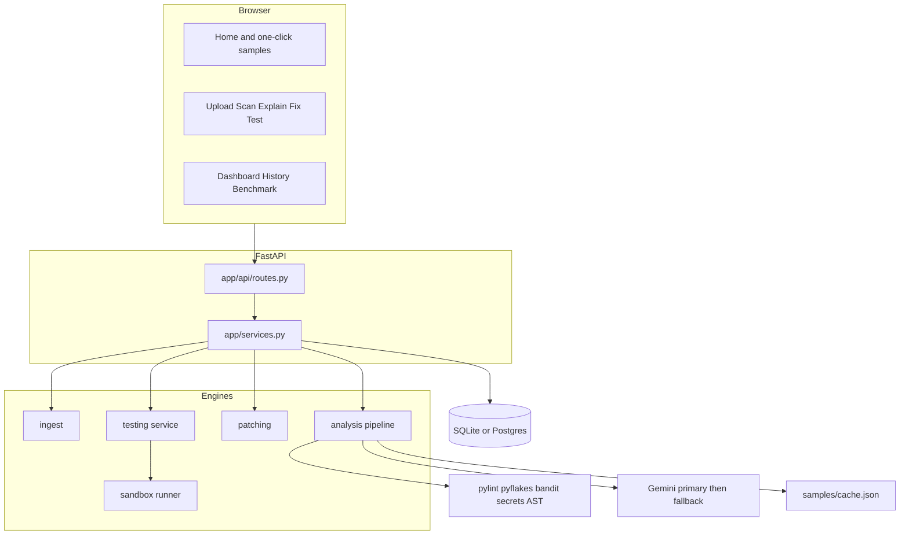

# Architecture

AutoPatch is one process. FastAPI serves the JSON API and, after `npm run build`, the React app from `frontend/dist`.

## Request path

1. Ingest copies the upload into `data/projects/{id}/source` and a working copy into `workspace`. The source copy is the original. Accepted patches are written only to the workspace.
2. `describe_project` builds the tree, language counts, dependency list, important-file list, and import graph. Those are stored on the project row as JSON text so SQLite and Postgres use the same schema.
3. A scan reads the workspace. AST rules, pylint, pyflakes, bandit, and the secret scanner run first. Gemini runs only when `GEMINI_API_KEY` is set. On failure the primary model is retried, then `GEMINI_FALLBACK_MODEL` is tried, each call bounded by `GEMINI_TIMEOUT_S`. Sample projects then attach `samples/cache.json` and the scan mode becomes `demo`.
4. `merge_findings` collapses two tools that saw the same file, rule, and symbol. The syntax-tree explanation is kept when it is the longer one. Confidence becomes the higher of the two.
5. For each actionable finding, `propose_fix` rewrites only that pattern and stores a unified diff plus the red/green excerpts. The file on disk is not changed.
6. A test run copies the workspace to a temp directory, runs pytest, writes `_autopatch_generated_test.py`, runs it, applies the fixers in another copy, and runs the generated tests and the full suite again. Events are inserted into `test_events` and streamed with SSE.
7. Accept calls the fixer again against the current workspace and writes the file. Reject only records a decision.

## Data

| Table | Holds |
| --- | --- |
| projects | Name, source, tree, languages, graph |
| scans | Status, mode (`live` or `demo`), tool notes |
| bugs | The six report fields, plus Kannada and Hindi text |
| patches | Diff, before, after, status |
| test_runs / test_events | Proof summary and the live log |
| decisions | Accept or reject |
| history_events | The timeline on the History page |

`DATABASE_URL` starting with `postgres://` or `postgresql://` is rewritten to `postgresql+psycopg://`. An empty URL uses `data/autopatch.db`.

## Why the rules are narrow

Each AST rule looks for one shape: a mark loop with no comparison, a division by `len(...)`, a divisor parameter, `deposit`/`withdraw` that never checks the amount, an f-string passed to `execute`, a secret assigned to a password-like name, a mutable default, `range(len(x))` that also reads `x[i + 1]`, and `range(1, len(x))` while indexing `x[i]`. They are not a general theorem prover. That is why the benchmark can be re-run without a model and why a low-confidence rule is labelled for a person.

## Sandbox

`run_in_sandbox` starts a new session, sets `RLIMIT_CPU`, `RLIMIT_AS`, and `RLIMIT_FSIZE`, and drops secret environment variables. Wall-clock time is `subprocess` timeout. Stdout and stderr are clipped to 8000 characters. Pytest is invoked as `sys.executable -m pytest` so the child uses the same interpreter that has pytest installed, without inheriting the API key.
