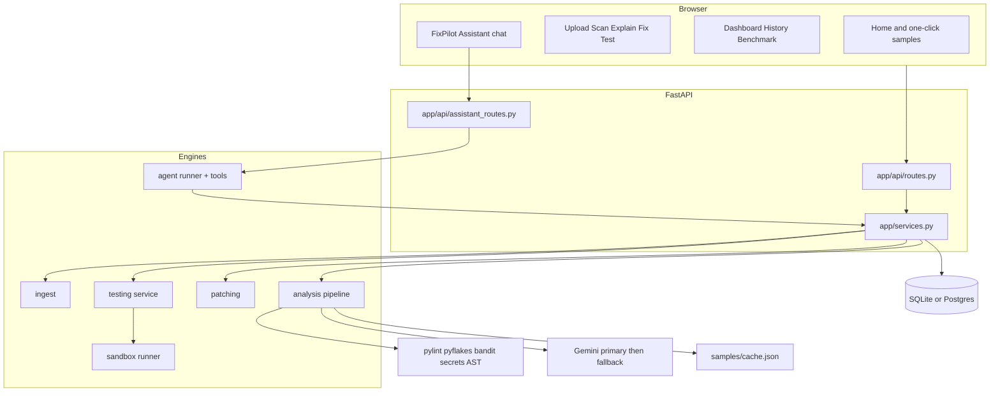

# Architecture

FixPilot is one process. FastAPI serves the JSON API and, after `npm run build`, the React app from `frontend/dist`.

## Request path

1. Ingest copies the upload into `data/projects/{id}/source` and a working copy into `workspace`. The source copy is the original. Accepted patches are written only to the workspace.
2. `describe_project` builds the tree, language counts, dependency list, important-file list, and import graph. Those are stored on the project row as JSON text so SQLite and Postgres use the same schema.
3. A scan reads the workspace. AST rules, pylint, pyflakes, bandit, and the secret scanner run first. Gemini runs only when `GEMINI_API_KEY` is set. On failure the primary model is retried, then `GEMINI_FALLBACK_MODEL` is tried, each call bounded by `GEMINI_TIMEOUT_S`. Sample projects then attach `samples/cache.json` and the scan mode becomes `demo`.
4. `merge_findings` collapses two tools that saw the same file, rule, and symbol. The syntax-tree explanation is kept when it is the longer one. Confidence becomes the higher of the two.
5. For each actionable finding, `propose_fix` rewrites only that pattern and stores a unified diff plus the red/green excerpts. The file on disk is not changed.
6. A test run copies the workspace to a temp directory, runs pytest, writes `_fixpilot_generated_test.py`, runs it, applies the fixers in another copy, and runs the generated tests and the full suite again. Events are inserted into `test_events` and streamed with SSE.
7. Accept calls the fixer again against the current workspace and writes the file. Reject only records a decision.

## Authentication & Coder ID

`users` stores `coder_id` (unique, e.g. `FP-CODER-7F3K2`; older `AP-CODER-` IDs still sign in), email, bcrypt `password_hash`, role (`student` / `developer` / `admin`), and login timestamps. `app/auth.py` issues HS256 JWTs signed with `JWT_SECRET` (24h). Routes take an optional Bearer token via `get_optional_user`; `GET /api/auth/me` requires one.

Projects, scans, patches, and decisions carry nullable `user_id`. Guest / demo mode creates projects with `is_guest=true` and no owner — judges can try the pipeline without signing up. Signed-in non-admins only list and open their own projects; admins see all. Profile stats aggregate scans, bugs, and decisions for that user.

## Auto-Correct Mode

The Fix UI drives a human-in-the-loop loop: propose → permission card → approve / reject / edit / skip. Approves call `decide_patch` with `verify_tests=True`; if the post-apply proof fails, the workspace file is restored and a `rolled_back` decision is stored. `workspace_versions` plus on-disk `data/projects/{id}/versions/vN` implement undo last / rollback all (v0 is the immutable `source/` copy). Safe bulk apply supports `dry_run` for a pre-flight list. Rejection reasons can call Gemini for an alternative snippet. The decision log is exposed at `/api/projects/{id}/decision-log` and embedded in JSON/PDF exports.

## AI Agent Assistant (FixPilot Assistant)

`/p/{projectId}/assistant` is a ChatGPT-style chat scoped to the uploaded project. Conversations and messages live in `conversations` / `chat_messages`, keyed by `project_id` and optional `user_id` (Coder ID). The browser streams replies over SSE (`POST /api/assistant/conversations/{id}/messages`).

`app/agent/runner.py` calls Gemini with tool declarations when `GEMINI_API_KEY` is set. Tools (`scan_file`, `explain_bug`, `propose_fix`, `run_tests`, `show_diff`, `search_code`) run in `app/agent/tools.py` against the workspace, scan findings, and existing patches. Each tool step is emitted as a small chat card. Proposed fixes appear as diff cards; Approve / Reject / Edit reuse `decide_patch` so the agent never writes code without a human click. Secrets are stripped via `app/agent/redaction.py` (path blocks for `.env` and content redaction using the secret scanner). Rate limits and a 4000-character message cap apply per user. If Gemini is unavailable, the runner falls back silently to rule-based answers from static findings — no demo banner.

## Data

| Table | Holds |
| --- | --- |
| users | Coder ID, email, password hash, role, last login |
| projects | Name, source, tree, languages, graph, `user_id`, `is_guest` |
| scans | Status, mode (`live` or `demo`), tool notes, `user_id` |
| bugs | The six report fields, plus Kannada and Hindi text |
| patches | Diff, before, after, status, `user_id` |
| test_runs / test_events | Proof summary and the live log |
| decisions | approved / rejected / edited / skipped / auto-applied / rolled_back + note + `user_id` |
| workspace_versions | Version timeline labels and paths (v0 original → vN) |
| history_events | The timeline on the History page |
| conversations | FixPilot Assistant threads per project / user |
| chat_messages | User and assistant turns, tool step JSON, proposed patch cards |

`DATABASE_URL` starting with `postgres://` or `postgresql://` is rewritten to `postgresql+psycopg://`. An empty URL uses `data/autopatch.db`.

## Why the rules are narrow

Each AST rule looks for one shape: a mark loop with no comparison, a division by `len(...)`, a divisor parameter, `deposit`/`withdraw` that never checks the amount, an f-string passed to `execute`, a secret assigned to a password-like name, a mutable default, `range(len(x))` that also reads `x[i + 1]`, and `range(1, len(x))` while indexing `x[i]`. They are not a general theorem prover. That is why the benchmark can be re-run without a model and why a low-confidence rule is labelled for a person.

## Sandbox

`run_in_sandbox` starts a new session, sets `RLIMIT_CPU`, `RLIMIT_AS`, and `RLIMIT_FSIZE`, and drops secret environment variables. Wall-clock time is `subprocess` timeout. Stdout and stderr are clipped to 8000 characters. Pytest is invoked as `sys.executable -m pytest` so the child uses the same interpreter that has pytest installed, without inheriting the API key.
